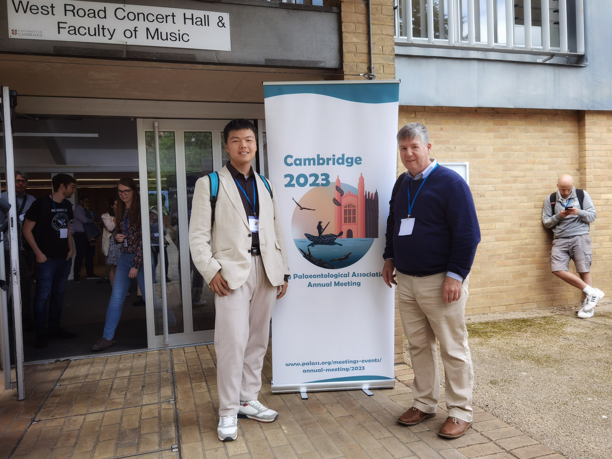
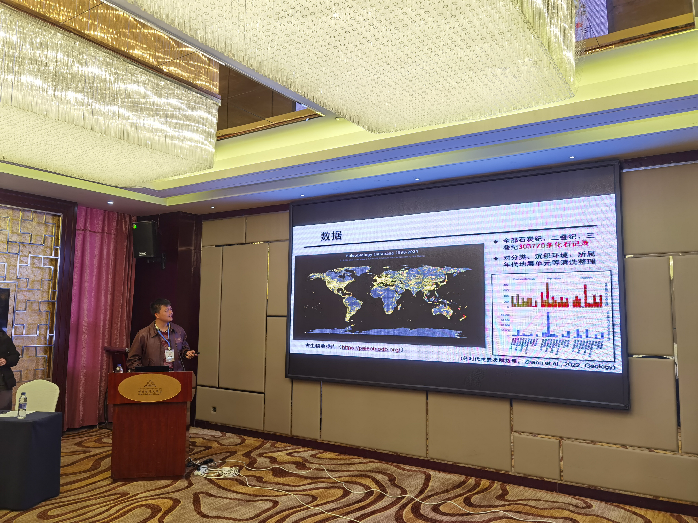
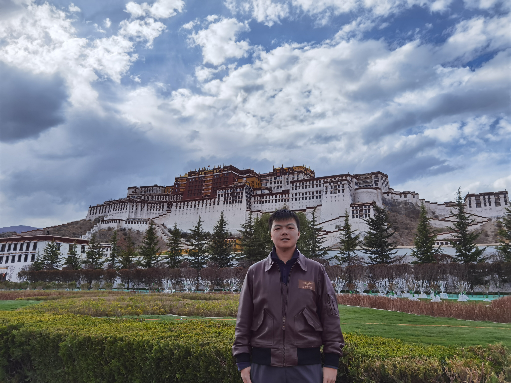
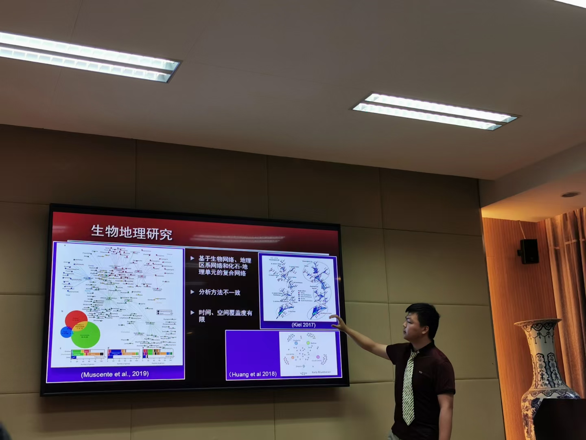
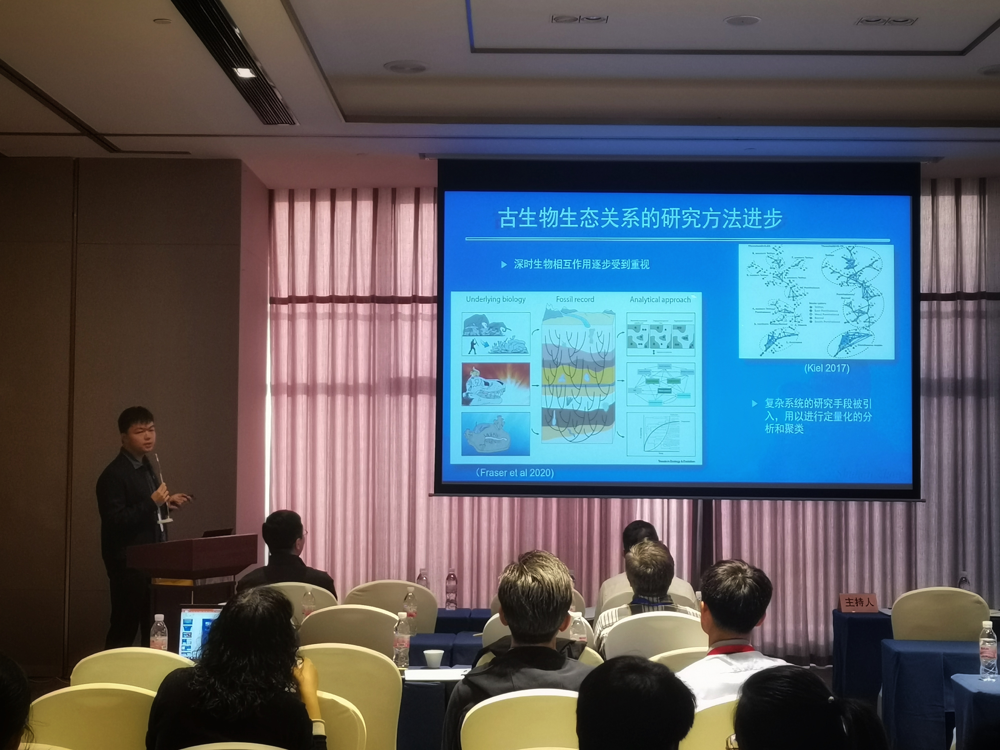
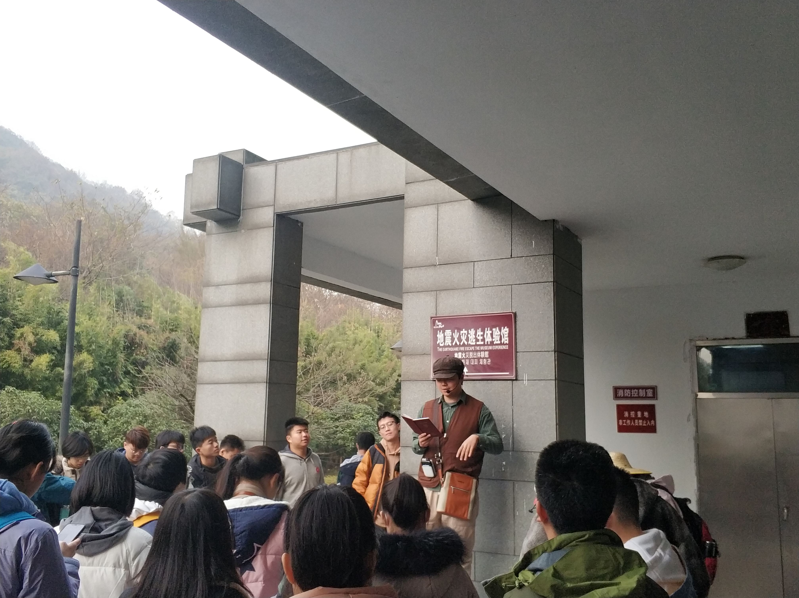
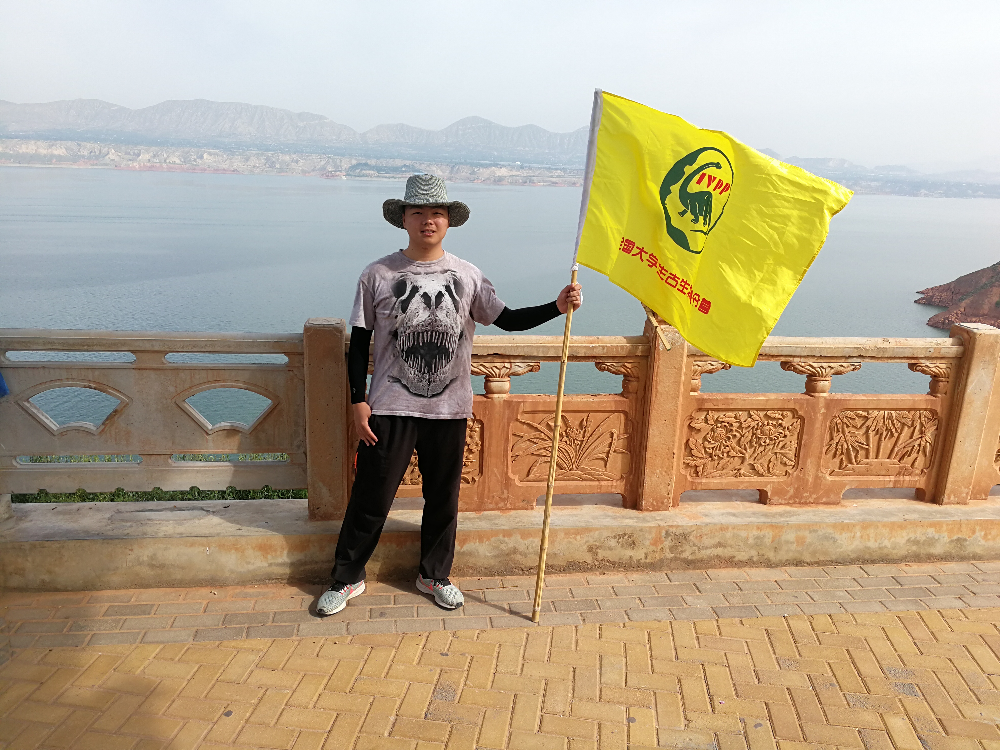
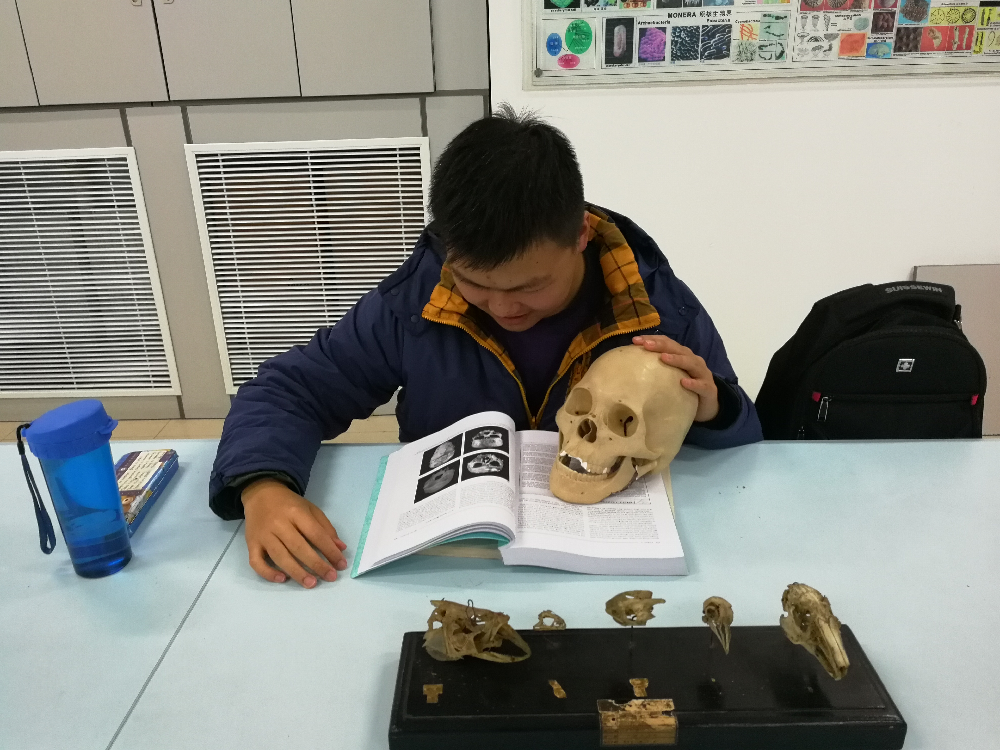

Honors and awards 获得荣誉
======

- 2023年 博士研究生国家奖学金（中华人民共和国教育部，2023年12月）
- 2022年 硕士研究生国家奖学金（中华人民共和国教育部，2022年12月）
- 江苏省省级优秀毕业生（江苏省教育厅、共青团江苏省委，2021年6月）
- 国家奖学金（2017—2018学年，中华人民共和国教育部，2018年11月）

 

Reports about me 相关报道
======

[乌镇Talk·开源青年说 \| 张书涵：地球科学基础模型帮助梳理46亿年地质记录](https://app.xinhuanet.com/news/article.html?articleId=20261102e5502c2b845b4119918534702ec1526e&share_device_token=8161AC1D-D8C5-462E-831F-18338499EC55&share_time=1793622028092&share_type=1&timestamp=4526)

[变冷促繁荣，变暖致灭绝：科学家用“时间显微镜”揭示3亿年前后海洋生物的生死启示](https://sciencesources.eurekalert.org/news-releases/1087934?language=chinese)

[国奖学生风采展：地球科学与工程学院2021级直博生张书涵](https://mp.weixin.qq.com/s/vUZOSGZobgL3Wetd_SXUHg)

[石炭纪至三叠纪全球生物多样性纬向分布模式通过大数据研究取得新进展](https://es.nju.edu.cn/e5/07/c22449a582919/page.htm)

[今天，南京大学地质学科迎来百年华诞！](https://mp.weixin.qq.com/s/WGFOBFDSIL6sAdB7EYq3hA)

[“走遍世界”，南大地质学长带你筑梦科研](https://baijiahao.baidu.com/s?id=1694387184169767697&wfr=spider&for=pc)

[地青春-张书涵：吾侪心事，古今长在，高山流水](https://mp.weixin.qq.com/s/lQcNkXDggPKeZz5mRBdzSg)

 

Popular science articles  科普文章
======

[石燕拂云晴亦雨：一场两亿年的兴亡回望](https://mp.weixin.qq.com/s/zAiCRznNgdR4Z2U8X0F6Iw)

[【科教融合系列】定量地层学—细翻记载沧海桑田的地史残卷](https://mp.weixin.qq.com/s/XrKHfoTBVZ3vrMUaHiZh_g)

[科教融合系列：撰写生命史诗——古生物遇上大数据（下篇）](https://ndsc.nju.edu.cn/5a/60/c11250a481888/page.htm)

[科教融合系列：撰写生命史诗——古生物遇上大数据 （上篇）](https://mp.weixin.qq.com/s/CqXo_OKg6w4cZCSZlsHRAA)

[以色列国的地中海（一） ——地科院以色列海法大学暑期课程纪实](https://mp.weixin.qq.com/s/uyJmTOWNWf6EkT9nw1Gs3A)

[亿年往事，独我与君通](https://mp.weixin.qq.com/s/YFPHYakSpJimlyWssxdSCw)

 

Some links 相关链接
======

School of Earth Sciences and Engineering, Nanjing Univeristy [https://es.nju.edu.cn/main.htm](https://es.nju.edu.cn/main.htm)

The Palaeontological Association [https://www.palass.org/](https://www.palass.org/)

International Commission on Stratigraphy [https://stratigraphy.org/](https://stratigraphy.org/)

Subcommission on Permian Stratigraphy [https://permian.stratigraphy.org/](https://permian.stratigraphy.org/)

Paleobiology Database [https://paleobiodb.org/](https://paleobiodb.org/)

OneStratigraphy database [https://onestratigraphy.ddeworld.org/](https://onestratigraphy.ddeworld.org/)

NSFC科学基金网络信息系统登录平台 [https://grants.nsfc.gov.cn/pmpweb/login](https://grants.nsfc.gov.cn/pmpweb/login)

stackoverflow [https://stackoverflow.com/](https://stackoverflow.com/)

 

<!-- Event photos 活动照片
======

PAL ASS meeting in Cambridge, 2023

Visiting student at Unviersity of Oxford, 2023

Meeting reports in Tibet, 2023

Field trips in Xinjiang, 2021

Field trips at the penglaitan section, the GSSP of the Lopingian, 2021

Defense of bachelor's thesis at Nanjing University, 2021

Meeting reports in Yunnan, 2020

Lead introduction of the Meishan section, the GSSP of the Triassic, 2019

Field trips at Lesvos island, Greece, 2019

Field trips at Hezheng, 2019

Field trips in New Zealand, 2018

Field trips at the Dead Sea, 2018

Studing at Nanjing University, 2017

 -->

 
 

A little tail 写在最后
------
<!-- Geology is the study of pressure and time. That's all it takes, really. Pressure and time. -->

亿万年来谁著史，八千里外赋新诗。
